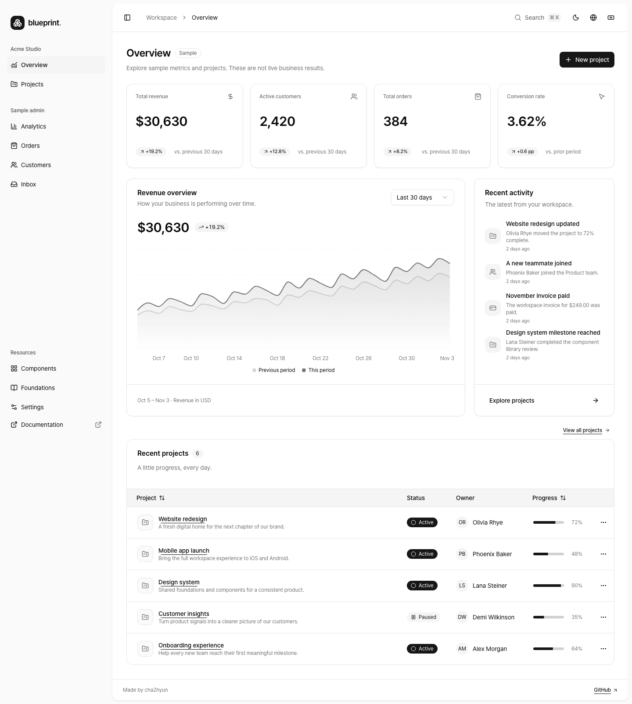
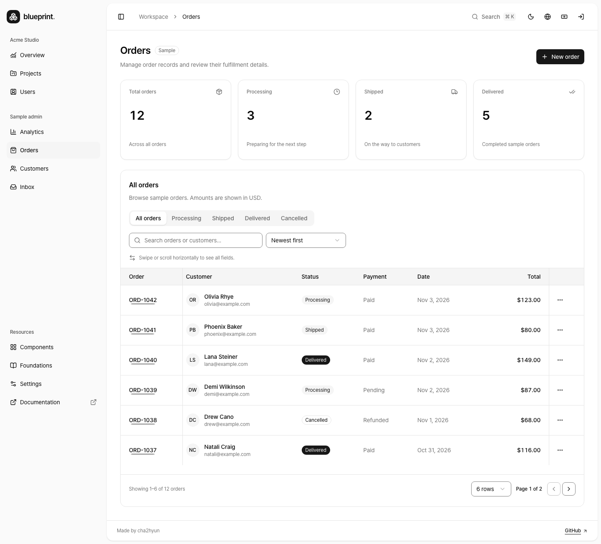
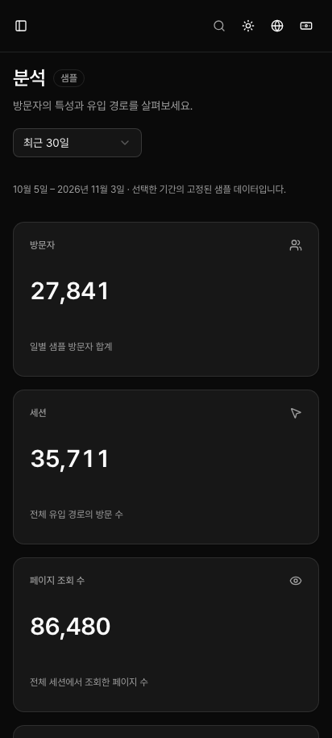

# Blueprint

React · TypeScript · Vite 기반의 제품 개발용 프런트엔드 보일러플레이트입니다. 대시보드, 프로젝트 관리, 분석, 주문, 고객, 샘플 로그인, 워크스페이스 사용자·내 계정, 받은편지함, 설정, Foundations 화면과 함께 FSD 구조, 서버/클라이언트 상태 분리, 디자인 토큰, 테스트, CI, AI 작업 가드레일을 제공합니다.

기본 실행은 **브라우저에 저장되는 데모 모드**입니다. 대시보드 수치는 샘플이며 실제 계정, 결제, 인증, 서버 권한 검사는 포함하지 않습니다. 운영 연결은 [API 계약](docs/api-contract.md)과 [운영 전환 체크리스트](docs/production-readiness.md)를 기준으로 진행하세요.

상단 **로그인**을 열면 이메일과 비밀번호에 편집 가능한 데모 값이 미리 입력되어 있습니다. **로그인**과 **Microsoft로 로그인**은 같은 출처의 데모 API에 요청하며, 성공하면 현재 탭에서 홈 대시보드가 열립니다. 보호된 내 계정이나 사용자 목록에서 로그인을 시작한 경우에는 해당 화면으로 돌아갑니다. 폼 아래 **데모 응답**에서 다음 요청을 느리게 하거나 서버 오류를 발생시켜 대기와 재시도를 확인할 수 있습니다. 잘못된 비밀번호로는 계정 오류도 재현할 수 있습니다. [로그인](docs/pages/login.md) · [내 계정](docs/pages/account.md)

[사용자](docs/pages/users.md)에서는 구매 고객과 별도로 워크스페이스 구성원의 역할·상태·초대 대기를 관리합니다.

Overview·Analytics·Orders·Customers·Users는 MSW가 실제 fetch에 목업 응답을 제공하고 TanStack Query가 캐시합니다. 최초 로딩과 데이터 화면은 같은 카드 크기를 유지하며, 핵심 수치는 API/캐시 진입 모두 300ms 모션을 사용합니다. [캐시 확인 방법](docs/query-cache.md)과 [숫자 표시 규칙](docs/number-formatting.md)·[로딩·모션 계약](docs/loading-and-motion.md)을 참고하세요. API 모드에서는 mock worker를 시작하지 않습니다.

다른 업무용 제품으로 포크할 때는 담당자가 할 일 한 가지를 먼저 정하고, 그 업무의 데이터 모델과 첫 화면을 만듭니다. 설비 점검 예시에서 `inspection`의 목록 조회·완료 처리, 라우트·목업·테스트 연결, 기본 샘플 제거 순서를 확인할 수 있습니다. [새 제품으로 시작하기](docs/new-project.md) · [도메인 교체 실습](docs/examples/minimal-admin.md)

## 미리보기

2026-11-06에 커밋 `1ee7ddf`의 production 데모 번들에서 캡처했습니다. 기능·탐색·정보 구조가 바뀌면 해당 커밋의 번들에서 소개 이미지도 갱신합니다. Overview 미리보기는 밝은 테마와 어두운 테마에 맞춰 표시됩니다. [캡처에 사용한 Actions 실행](https://github.com/cha2hyun/boilerplate/actions/runs/42149542188)

<picture>
  <source media="(prefers-color-scheme: dark)" srcset="docs/images/overview-dark.png" />
  <source media="(prefers-color-scheme: light)" srcset="docs/images/overview-light.png" />
  
</picture>

<details>
  <summary>주문 목록과 모바일 분석 화면 보기</summary>

### Orders · 데스크톱



### Analytics · 모바일



</details>

## 실행

헤더의 언어·통화 아이콘 메뉴에서 한국어·영어와 USD·KRW 표시를 각각 선택할 수 있으며 설정은 브라우저에 저장됩니다. 환율은 demo/api 모드 모두 Frankfurter 공개 API에서 실제로 조회합니다. 통화 메뉴 안에 환율을 표시하고, 원본 USD 금액을 환산합니다. 유효한 환율이 없으면 원화 금액은 `—`로 표시하며 같은 메뉴에서 재시도를 제공합니다. 번역·숫자·날짜·환율의 소유 경계는 [언어와 표시 통화](docs/i18n.md)를 따릅니다.

Node.js 24 LTS와 pnpm 11을 사용합니다. 정확한 pnpm 버전은 `package.json`의 `packageManager`를 따릅니다.

```sh
pnpm install --frozen-lockfile
cp .env.example .env.local
pnpm dev
```

Vite가 출력하는 로컬 주소에서 확인하세요. 기본 포트는 `5173`입니다. `.env.local`을 생략해도 기본 데모 설정으로 실행됩니다. 앱에서 생성/수정/삭제한 데모 프로젝트는 같은 브라우저의 localStorage에 저장됩니다. 이 데이터는 다른 사용자나 기기와 공유되지 않습니다.

개발 모드에서는 오른쪽 아래 **TanStack Devtools** 버튼 하나로 Query와 Router 패널을 전환합니다. [공식 플러그인 방식](https://tanstack.com/devtools/latest/docs/quick-start)을 사용하며 `import.meta.env.DEV` 경계에서 지연 로드하므로 production 진입 코드에는 포함하지 않습니다.

관리자 경로는 공개 origin을 설정해도 기본 `noindex`이며, 공개할 경로만 별도 `publicIndexablePaths`에 지정합니다. 페이지별 제목/OG/Twitter 메타는 하나의 registry로 관리하며, 빌드 시 경로마다 메타가 들어간 정적 HTML shell을 만듭니다. React 화면은 CSR로 실행합니다. 공유 이미지의 절대 URL과 canonical을 만들려면 배포 전에 `VITE_SITE_URL`에 실제 공개 origin을 설정하세요. 파비콘·모바일 북마크 아이콘과 호스팅 경로 규칙은 [메타데이터 가이드](docs/seo.md)에 정리했습니다.

```dotenv
VITE_DATA_SOURCE=demo
VITE_API_BASE_URL=/api
```

`VITE_DATA_SOURCE=api`로 바꾸면 실제 API 어댑터를 사용합니다. 환경 변수는 Vite 빌드 시 번들에 포함되므로 변경 후 개발 서버 재시작/재빌드가 필요합니다. `VITE_` 변수에는 비밀 값을 넣지 마세요.

## 폴더 구조

주요 폴더와 파일을 역할별로 추리면 다음과 같습니다.

```text
boilerplate/
├── src/
│   ├── main.tsx         # 번역과 데모 목업을 준비하고 React 앱을 시작
│   ├── app/             # 라우터와 데이터·테마 설정 등 앱 전체를 조립
│   │   ├── routes/      # URL을 화면에 연결하고 접근 조건과 검색 조건을 처리
│   │   ├── providers/   # QueryClient, 테마, 언어 등 앱 전반의 설정
│   │   ├── mocks/       # MSW로 데모 HTTP 요청에 응답
│   │   └── styles/      # 전역 CSS와 색상·폰트 토큰
│   ├── pages/           # 로그인, 주문, 설정처럼 URL별 화면을 구성
│   ├── widgets/         # 헤더·사이드바가 있는 앱 셸, 프로젝트 표, 매출 차트
│   ├── features/        # 데모 로그인, 주문 편집 등 사용자가 수행하는 동작
│   ├── entities/        # 주문·고객·사용자 등 도메인별 모델, API, Query 옵션
│   ├── shared/          # 여러 도메인에서 공통으로 사용하는 코드
│   │   ├── api/         # HTTP 요청, 응답 검증, 오류 처리
│   │   ├── config/      # 환경 변수, 제품 이름, 저장소 키
│   │   ├── hooks/       # 화면 크기 감지, 미저장 입력 보호 등 공통 React 훅
│   │   ├── lib/         # 번역, 숫자·날짜 표시 등 공통 로직
│   │   └── ui/          # 버튼, 입력, 메뉴 등 공통 UI 컴포넌트
│   └── test/            # Vitest 공통 설정 (단위 테스트는 대상 코드 옆에 배치)
├── public/              # 그대로 제공하는 아이콘, 아바타, 목업 서비스 워커
├── e2e/                 # Playwright로 검증하는 사용자 흐름과 화면 비교 기준
├── scripts/             # 구조·문서 검사, 빌드 검증, 브랜드 자산 생성
├── docs/
│   ├── pages/           # 페이지별 목적, 동작, 수용 기준
│   ├── design/          # 레이아웃, 색상, 타이포그래피 등 UI 규칙
│   └── adr/             # 아키텍처 결정과 그 이유
├── .github/             # CI 워크플로, Dependabot 설정, 이슈·PR 템플릿
└── .husky/              # 커밋 전 검사와 커밋 메시지 검사
```

예를 들어 **주문 목록의 열을 바꿀 때**는 `src/pages/orders/`, **주문 편집 폼을 바꿀 때**는 `src/features/order-editor/`, **주문 API나 응답 스키마를 바꿀 때**는 `src/entities/order/`에서 시작하면 됩니다. 레이어 간 import는 `app → pages → widgets → features → entities → shared` 순서에서 아래 방향으로 허용됩니다. [아키텍처와 import 규칙](docs/architecture.md)

## 기술 선택

| 역할            | 구현                                                              |
| --------------- | ----------------------------------------------------------------- |
| 앱/빌드         | React 19, TypeScript 6.0 strict, Vite 8, pnpm                     |
| 구조            | Feature-Sliced Design, 슬라이스 공개 API, 자동 import 경계 검사   |
| UI              | shadcn/ui, Radix, Tailwind CSS 4, shadcn neutral 의미 토큰        |
| 아이콘          | lucide-react                                                      |
| 폰트            | Pretendard 동적 subset CDN(jsDelivr), 400 / 500 / 600             |
| URL/탐색        | TanStack Router                                                   |
| 서버 데이터     | TanStack Query, 취소 가능한 요청, Zod 응답 검증                   |
| 목업 HTTP       | demo 전용 MSW, 요청 횟수와 Query 캐시 재사용 검증                 |
| 클라이언트 상태 | Zustand                                                           |
| 테이블/차트     | TanStack Table, shadcn Chart/Recharts                             |
| 품질            | ESLint typed rules, Prettier, Vitest, Testing Library, Playwright |
| 협업            | Husky, lint-staged, commitlint, GitHub Actions, Dependabot        |
| AI 작업         | AGENTS.md, 계획 템플릿, 구조 검사, shadcn MCP 설정/점검           |

직접 작성한 컴포넌트 CSS는 없습니다. `src/app/styles/globals.css`만 Tailwind 진입점, shadcn 토큰, 기본 스타일을 선언합니다. 화면은 Tailwind 유틸리티로 조합하고 컨트롤은 `src/shared/ui`의 shadcn 컴포넌트를 사용합니다.

테마는 [공식 shadcn Vite recipe](https://ui.shadcn.com/docs/dark-mode/vite)를 기반으로 하며 light/dark/system 선택과 시스템 설정 변경을 지원합니다. 기존 `blueprint-theme` 저장 키를 사용하고 저장소를 사용할 수 없어도 현재 세션의 테마 선택은 동작합니다.

기본 UI는 무채색을 유지합니다. `primary`는 주요 동작, `brand`는 단일 Blueprint Blue 정체성 색상으로 구분합니다. 글자 두께는 `font-normal`(400), `font-medium`(500), `font-semibold`(600)만 허용하며 구조 검사기가 위반을 막습니다. 세부 사용 규칙은 [디자인 시스템](docs/design-system.md), 실제 토큰과 한글/영문 폰트 표본은 앱의 **Components → Theme tokens / Typography**에서 확인하세요.

## 샘플 페이지

| 메뉴                  | 제공하는 흐름                                                            |
| --------------------- | ------------------------------------------------------------------------ |
| Overview / Projects   | 기간별 요약, 프로젝트 상세→편집, 생성·삭제, 검색·필터                    |
| Analytics             | 기간 선택, 방문/기기 차트, 유입 경로와 인기 페이지                       |
| Orders                | 서버 조회 계약의 검색·정렬·페이지, 별도 상세·요약, 생성·수정·삭제        |
| Customers             | 고객 생성·수정·삭제, 상태 필터·검색·정렬, 고객 상세 Sheet                |
| Login / My account    | 데모 값 제출·Microsoft 데모 로그인, 탭 세션 복원·종료, 내 역할·상태 확인 |
| Users                 | 내부 구성원 조회·검색·상세, 초대 대기 생성·역할/상태 수정                |
| Inbox                 | 검색, 읽음/읽지 않음, 보관·복원, 메시지 상세                             |
| Components / Settings | shadcn 구성 요소·토큰·폰트, 테마와 워크스페이스 설정                     |
| Foundations           | 디자인 규칙, HStack/VStack 조합, 문구·국제화·피드백 예시                 |

주문/고객은 HTTP 목업을 통해 생성·수정·삭제하고 브라우저 저장소에 보존합니다. 저장소를 사용할 수 없으면 현재 탭의 메모리에서만 유지되며 셸에서 새로고침·종료 시 사라질 수 있음을 안내합니다. 고객 구매 이력과 주문의 고객 정보는 독립된 샘플이며 서로 연쇄 변경하지 않습니다. 받은편지함 변경은 페이지를 떠나면 초기화됩니다. 실제 메일 발송이나 결제 기능은 없습니다. 모바일(768px 미만)은 사이드바 drawer, 태블릿(768–1279px)은 기본 아이콘 탐색, PC(1280px 이상)는 펼친 사이드바를 사용합니다. 접힌 로고·메뉴는 같은 중심선을 사용합니다. 설정은 Resources 메뉴에서 엽니다. 저장한 워크스페이스 이름은 첫 탐색 그룹 제목에 즉시 반영되며 하단 프로필·워크스페이스 전환 블록은 표시하지 않습니다.

Projects·Orders·Customers의 **보기 설정**에서 열 표시·너비·순서·좌우 고정과 행 간격을 바꿀 수 있습니다. 태블릿/PC에서는 헤더 핸들로 드래그하거나 방향키로 이동·크기를 조절하고, 모바일에서는 설정 창으로 조작합니다. 설정은 표별로 현재 브라우저에 저장되며 **기본값 복원**은 검색·정렬·페이지를 유지합니다. Overview 요약 표에는 적용하지 않습니다. [보기 설정 저장 계약](docs/url-state.md#표-보기-환경-설정)

Foundations는 기존 shadcn·Pretendard·색상 규칙을 설명하는 페이지입니다. HStack/VStack은 교차축 중앙 정렬을 기본으로 하는 공통 레이아웃 컴포넌트입니다. 직접 작성한 행·열 배치는 [레이아웃 규칙](docs/design/layout.md)에 따라 Stack으로 통일합니다.

## 명령

| 명령                             | 용도                                                         |
| -------------------------------- | ------------------------------------------------------------ |
| `pnpm dev`                       | 로컬 개발 서버                                               |
| `pnpm build` / `pnpm preview`    | 타입 검사 및 정적 번들 / 로컬 빌드 확인                      |
| `pnpm check`                     | 로컬 정적 검사: 포맷, 린트, 타입, 구조, E2E 범주             |
| `pnpm check:ci`                  | Actions용 정적 검사, 가드레일/단위 테스트, 빌드              |
| `pnpm test` / `pnpm test:watch`  | 단위/컴포넌트 테스트 / watch                                 |
| `pnpm test:coverage`             | 테스트 커버리지 리포트                                       |
| `pnpm test:e2e`                  | Playwright 브라우저 테스트 (`pnpm build` 후 실행)            |
| `pnpm check:architecture`        | FSD, shadcn 컨트롤, 스타일/토큰 규칙 검사                    |
| `pnpm check:unit-categories`     | 단위 테스트의 누락·중복 범주·미지원 이름 검사                |
| `pnpm check:e2e-categories`      | E2E 범주의 누락·중복·없는 스펙 경로 검사                     |
| `pnpm check:page-specs`          | 페이지 기획 누락·중복·필수 항목·로컬 링크 검사               |
| `pnpm check:browser-image`       | CI 브라우저 이미지와 설치된 Playwright 버전·고정 digest 검사 |
| `pnpm check:docs`                | Markdown 로컬 파일과 절 링크 검사                            |
| `pnpm check:bundle-budget`       | 빌드 후 초기 정적 JS의 raw/gzip 예산 검사                    |
| `pnpm test:guardrails`           | 구조 검사기, 경로별 HTML, E2E 범주 회귀 테스트               |
| `pnpm format` / `pnpm lint`      | 포맷 적용 / 린트 검사                                        |
| `pnpm ui:add <component>`        | 설정된 shadcn registry에서 컴포넌트 추가                     |
| `pnpm ui:mcp` / `pnpm check:mcp` | shadcn MCP 서버 / 실제 도구 연결 점검                        |
| `pnpm assets:generate`           | SVG 소스에서 파비콘·북마크·공유 이미지 재생성                |

전체 단위/E2E 테스트는 **GitHub Actions가 기본 실행 위치**입니다. 명시 요청이나 필요한 결함 재현이 없으면 로컬에서 전체 테스트를 실행하지 않습니다. 필요한 경우 파일·기능·화면 크기만 선택하며 [테스트 실행 정책](docs/testing.md)에 범주별 명령을 정리했습니다.

CI는 production build를 한 번만 만들고 초기 JS 예산을 검사한 뒤 `core`·`samples` 브라우저 job이 같은 번들을 공유합니다. 브라우저와 OS 의존성은 설치된 Playwright와 버전을 맞춘 digest 고정 이미지에서 제공하므로 각 job에서 Ubuntu 패키지를 다시 설치하지 않습니다. Chromium에서 PC·태블릿·모바일을 확인하고, core job 안에서 WebKit 모바일의 날짜 입력·입력 보호·탐색과 표 스크롤 두 smoke 시나리오를 별도로 확인합니다. 전체 시나리오를 엔진별로 반복하거나 dev 서버 테스트를 중복 실행하지 않습니다. 브라우저 job은 최대 2개, 각 worker는 2개입니다. 로컬 브라우저 재현이 필요한 경우에만 `pnpm exec playwright install chromium`으로 준비하고, WebKit smoke를 재현할 때는 `pnpm exec playwright install webkit`도 실행하세요. 모든 PR에는 최종 `CI Gate`가 생성되며 문서 전용 변경은 무거운 job을 생략합니다. 포크 후 [main 보호 설정](docs/ci-gate.md)은 원격에서 별도로 적용·확인해야 합니다.

## 구조와 문서

- [작업별 문서 지도](docs/README.md) — 필요한 책임의 문서만 선택
- [페이지별 현재 기획과 수정 방법](docs/pages/README.md) — 목적·동작·상태·수용 기준
- [새 제품 도입·브랜드·데모 정리](docs/new-project.md) · [다른 도메인으로 교체하는 포크 실습](docs/examples/minimal-admin.md)
- [아키텍처와 경계](docs/architecture.md)
- [폰트·색상·반응형 규칙](docs/design-system.md)
- [공통 화면 조합](docs/design/compositions.md) · [시각 기준 검토](docs/design/visual-regression.md)
- [테스트 범주와 Actions 실행 정책](docs/testing.md)
- [페이지별 OG·파비콘·북마크](docs/seo.md)
- [시니어 코드 리뷰와 수정 근거](docs/reviews/production-code-review.md)
- [Lighthouse 측정 결과와 개선](docs/reviews/lighthouse-audit.md)
- [API 계약과 데모 어댑터](docs/api-contract.md)
- [Query 키·캐시·목업 검증](docs/query-cache.md)
- [카드 로딩·숫자 모션](docs/loading-and-motion.md)
- [운영 전환 체크리스트](docs/production-readiness.md)
- [AI 작업 흐름](docs/ai-workflow.md) · [에이전트 지침](AGENTS.md)
- [미저장 입력 보호](docs/unsaved-changes.md) · [앱 오류 복구와 보고 연결](docs/error-handling.md)
- [기여/커밋/PR 규칙](CONTRIBUTING.md)
- [작업 계획 템플릿](docs/plans/_template.md)
- [외부 소스 라이선스 고지](THIRD_PARTY_NOTICES.md)

`src/shared/config/product.ts`에서 공개 제품 이름·셸 링크·작성자·기본 워크스페이스와 제품의 테마·환경 설정·데모 데이터 localStorage 키를 관리합니다. 기존 키 값은 유지하며 포크는 [새 제품 도입](docs/new-project.md)의 확인 절차에 따라 고유 namespace를 정합니다.

새 기능은 책임을 배치하고 테스트 가능한 완료 조건을 먼저 정하세요. 데모 데이터를 실제 데이터처럼 표시하거나 미구현 기능을 완료된 것으로 설명하지 마세요.
